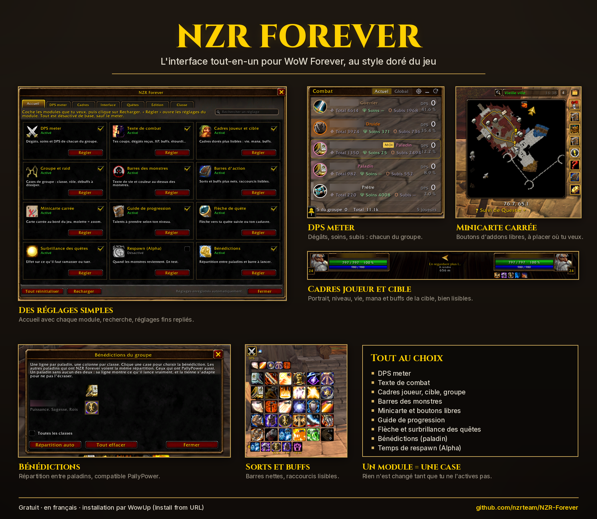
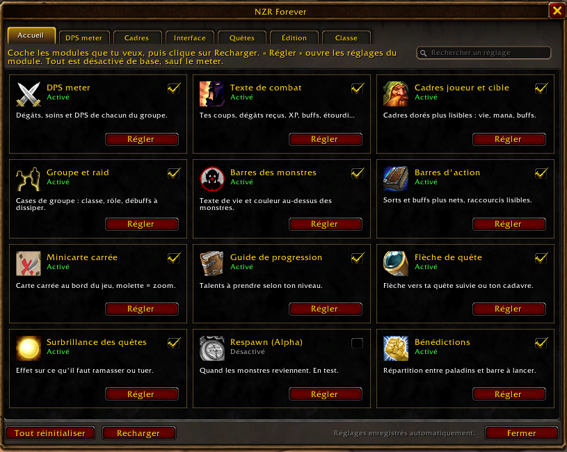
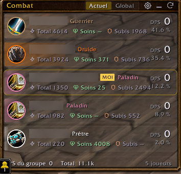
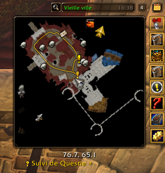
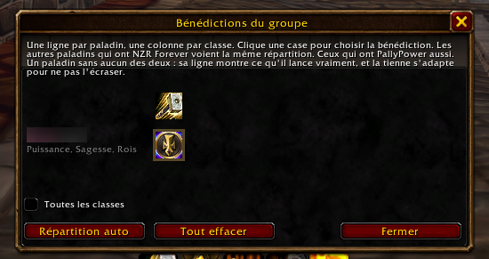

# NZR Forever

[🇫🇷 Français](README.md) · 🇬🇧 English

The all-in-one interface for **WoW Forever**, in the game's own golden style. Every module is turned on with a single checkbox: nothing changes until you enable it. The addon's interface is in French.

## Modules
- **DPS meter**: damage, healing and damage taken for everyone in your group; Detailed, Table and Bars views; Game, Black or Purple theme.
- **Combat text**: your hits, damage taken, XP, kills, buffs and procs, stuns, combat start and end.
- **Player, target, party and raid frames**: portrait, level, health, mana, buffs and debuffs, easy to read.
- **Nameplates**: health text and colours.
- **Spells and buffs**: clean bars, readable keybinds.
- **Square minimap**: other addons' buttons set free (square or round), placed anywhere, with Undo and Reset.
- **Quests**: levelling guide (talents), arrow to your quest, highlight of what to loot or kill, monster respawn timers (Alpha).
- **Blessings (paladin)**: blessing assignments between paladins, **PallyPower** compatible; a paladin without the addon is never overwritten.
- **Handy extras**: edit mode to place everything, opaque tooltips, movable game windows, fast loot.

Settings: `/nzr`, the golden icon near the minimap, or Esc > NZR Forever. The **Home** tab shows every module; the **search** box finds any setting.

| | |
|---|---|
|  |  |
|  |  |

## Made with Claude, and proud of it
Yes, NZR Forever is built with the help of **Claude** (Anthropic's AI). This is "vibe coding", and honestly, real knowledge paired with AI is hard to beat.

The AI saves a huge amount of time: writing the code, figuring out how the game's API works, fixing a bug in minutes. But it doesn't replace the rest: knowing what you want, knowing the game, testing for real, spotting what's off down to the pixel, and choosing where the project goes. That combination is what makes the addon.

## Install and update with WowUp
1. Install [WowUp](https://wowup.io) and add your `_forever_` folder.
2. *Get Addons* > *Install from URL* > paste this repository's address.
3. New versions then show up in WowUp.

## Manual install
Download the zip from the latest [release](../../releases/latest) and extract it into `_forever_\Interface\AddOns\`.
