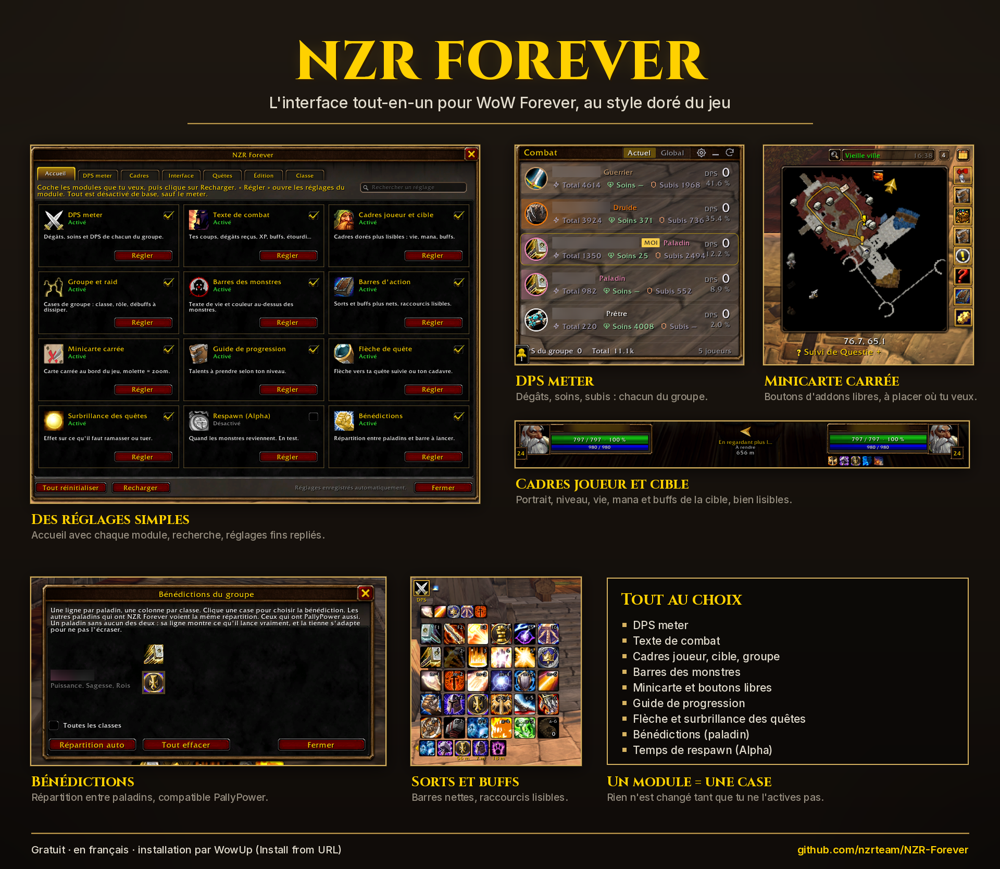
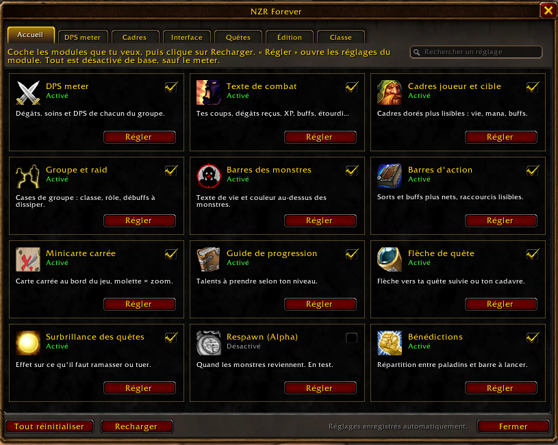
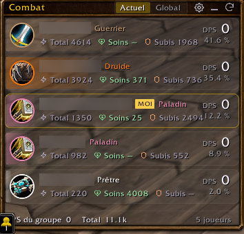
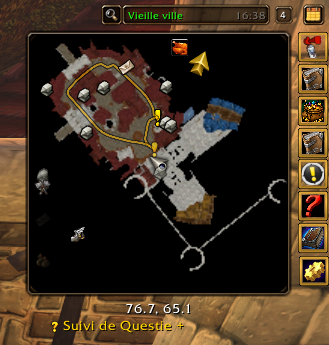
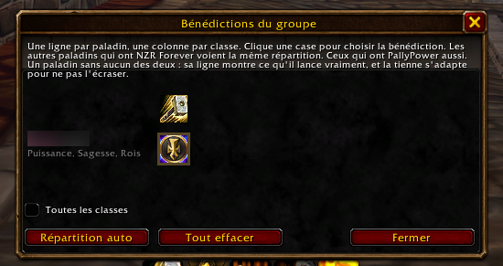

# NZR Forever

L'interface tout-en-un pour **WoW Forever**, au style doré du jeu. Chaque module s'active d'une case : rien n'est changé tant que tu ne l'actives pas.

## Modules
- **DPS meter** : dégâts, soins et dégâts subis de chacun du groupe ; vues Détaillé, Tableau et Barres ; teinte Jeu, Noir ou Violet.
- **Texte de combat** : tes coups, dégâts reçus, XP, monstres tués, buffs et procs, étourdissements, début et fin de combat.
- **Cadres joueur, cible, groupe et raid** : portrait, niveau, vie, mana, buffs et débuffs, bien lisibles.
- **Barres des monstres** : texte de vie et couleurs.
- **Sorts et buffs** : barres nettes, raccourcis lisibles.
- **Minicarte carrée** : boutons des autres addons libres (carrés ou ronds), à placer où tu veux, avec Annuler et Par défaut.
- **Quêtes** : guide de progression (talents), flèche vers ta quête, surbrillance de ce qu'il faut ramasser ou tuer, temps de respawn des monstres (Alpha).
- **Bénédictions (paladin)** : répartition entre paladins, compatible **PallyPower** ; un paladin sans addon n'est jamais écrasé.
- **Pratique** : mode édition pour tout placer, infobulles opaques, fenêtres du jeu déplaçables, butin rapide.

Réglages : `/nzr`, l'icône dorée près de la minicarte, ou Échap > NZR Forever. L'onglet **Accueil** montre chaque module ; la **recherche** trouve n'importe quel réglage.

| | |
|---|---|
|  |  |
|  |  |

## Installation et mises à jour avec WowUp
1. Installe [WowUp](https://wowup.io) et ajoute ton dossier `_forever_`.
2. *Get Addons* > *Install from URL* > colle l'adresse de ce dépôt.
3. Les nouvelles versions apparaissent ensuite dans WowUp.

## Installation à la main
Télécharge le zip de la dernière [release](../../releases/latest) et décompresse-le dans `_forever_\Interface\AddOns\`.
